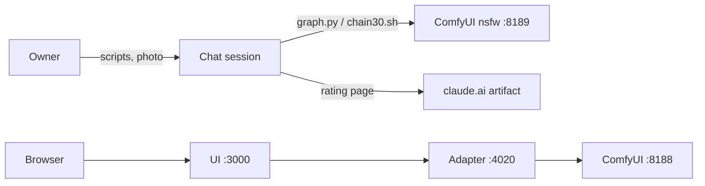
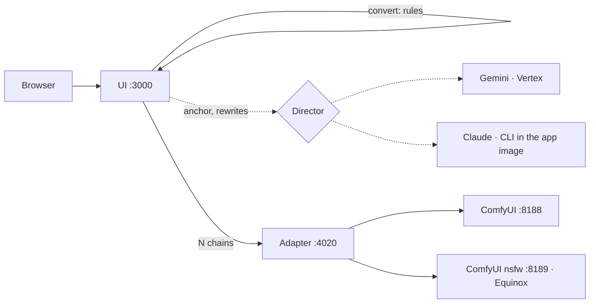
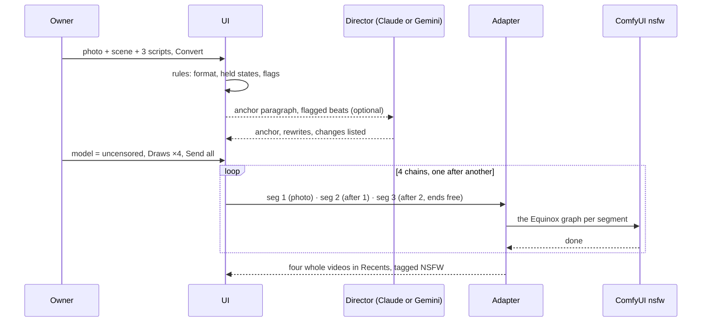

# EPIC_011 — The test rounds run from the UI

**Status:** Proposed (2026-10-09 11:05 EDT — drafted at the owner's request after three weeks of test rounds run from the chat: "I really enjoy working with you in chat to do this but I would like to ensure I am able [to do] what we have been doing using the UI"; the scope chosen by the tool 10:40: Equinox in the composer, draws per chain, a script converter with a choice of Claude CLI or the Gemini director; the in-app rating page declined for now)
**Started:** —
**Decisions of 2026-10-09 (the owner, by the tool):** the stack is **Equinox** and stays as is (HMPenis v2 0.45 + Male_Anatomy v2.02 0.4 on Eros Max TURBO hybrid beta5 int8, 8 steps `res_multistep`/`simple` — [horse-codenames], decided 2026-10-05 and confirmed 2026-10-07); the converter is **rules in code** with the model step on **either Claude (his subscription, through the Claude Code CLI) or the Gemini director**, chosen by him; nothing is built until each story is approved; STORY_064–065 are revised into this epic, STORY_066 is superseded by STORY_070.

## Goal

Everything the test rounds have done by hand since 2026-09-19 — pick the photo, convert the owner's three bracketed scripts into the model's format under the rules the rounds taught us, draw N whole 31-second videos on the Equinox stack with fresh seeds one after another, and watch them land — becomes a **Send** in MiniMax Local. After this epic the owner attaches the photo, pastes his scene paragraph and three scripts, presses **Convert** (the rules run in the app; the director drafts the photo paragraph on Claude or Gemini if he wants), picks *MiniMax-H3 (uncensored)* in the model menu, sets *Draws ×4*, and presses **Send all**: four chains go out, each whole video lands in Recents in turn, tagged *NSFW*, and the chat is for judging them, not for running them.

**What the rounds taught, now written as rules the product enforces** (each is a memory file today; the converter story turns them into checks):

| Rule | Learned | Where it bites |
| --- | --- | --- |
| A change of state in script 2 snaps back at ~20.5 s — props, clothing **and poses** | the towel (2026-10-05), the sunglasses (10-08), the hands (10-08/09) | the middle segment is pinned to its first frame (STORY_061); script 2 must end where it began |
| A prop the model fumbles (a towel) is dropped in script 1 and never mentioned again | 13 of 13 towel beats went wrong (10-05/06) | the converter flags a prop named after script 1 |
| Back scripts keep their bends shallow until a better adapter lands (the rule of 2026-10-09, memory `back-scripts-shallow-bends-only`) | the home back round (10-09): the shallow bend passed, the deep one did not | a flag on the beats the rule names; the list lives in the converter's rule table |
| No anatomy wording of the assistant's — the owner's words pass through verbatim (memory `no-genital-wording-of-mine`) | 2026-10-03 | the converter adds no such words; the director's anchor instruction says so |
| The anchor holds only what never changes — no pose, no changing state | 2026-09-25 | the director's anchor instruction |
| Seeds are the adapter's; N videos means N fresh seeds, one after another | every round | draws per chain |

**Constraints carried from [EPIC_010](EPIC_010_an_nsfw_model_in_its_own_container.md)** (the licence, read 2026-09-19): nothing involving minors; reference photos of consenting adults or generated people the owner names (every round's photo since 2026-10-07 was a generated image, his answer each time); the NSFW model reachable by the owner alone (the container on 127.0.0.1 and the compose network; the UI LAN-only). **One decision of that epic is reversed here by the owner:** "the prompts come from our own director skill, run by the assistant, never Vertex" — on 2026-10-09 he chose a director that runs on Claude **or Gemini** from the app; STORY_071's open question asks him to confirm that the photo may go to either provider.

## What exists today (read from the code and the box, 2026-10-09 10:45–11:05 EDT)

- **The adapter has one upstream and no LoRA support.** `spark/adapter/src/server.ts` takes one `comfyUrl` and one `graphTemplate` (`h3_t2v_prompt.json`); `mapping.ts` › `buildGraph` wires the guider and sampler to the template's `unet` node, and `REQUIRED_CLASSES` lacks `LoraLoaderModelOnly`; `CAPABILITIES.models` has the one entry; a job while ComfyUI is down answers 503 `NOT_RUNNING` (`server.ts:313, 462`). `/health` reports adapter **1.7.0** (read on the Spark 2026-10-07 at `run.sh --nsfw`); the contract file is at **v1.5**. `spark/comfyui/compose.yaml` already mounts `output-nsfw` read-only into the adapter (STORY_063, line 75) "read by STORY_064".
- **The NSFW container runs Equinox every night — from test tooling, not the product.** `test/<round>/graph.py` builds the graph the adapter should build: the SFW template with `unet_name` swapped to `10Eros_Max_h3_TURBO-hybrid_beta5_int8.safetensors`, `sigmas.steps` 8, `lora_1` (`PenisV2_minimax-h3_epoch60.safetensors` 0.45) → `lora_2` (`Male_Anatomy-v2.02-ep4.safetensors` 0.4) chained from `unet`, and every `["unet", 0]` input rewired to the last LoRA node; `extend.py` does the same for the +10 s masked continuation with `anchorEnd` on except the last segment; `chain30.sh` joins the three segments with STORY_067's lossless audio pieces. 60 whole videos drew this way between 2026-10-05 and 10-09 (dark 20, pavilion 12, boat 16, home 12), **no failures**, ≈ 81 min each (seg 1 ≈ 21 min, each +10 s ≈ 30 min; the first job after a reboot ≈ 35 min for the model load).
- **The composer already splits the owner's scripts into a chain.** `lib/chain.ts` › `splitChain` cuts the text at every `[0:00-` line, the text before the first is the *scene* and is prefixed to every segment (`segmentPrompt(chain.scene, script)`, `Composer.tsx:378`); the chain strip (STORY_044, `ChainStrip.tsx`) shows the segments; **Send all** posts them with `submitChain` (`lib/submit-job.ts:153`, the last segment unpinned since STORY_068). The adapter wraps a plain segment in the model's format (`prompt.ts`, STORY_020) and **passes a prompt that already begins with the format unchanged** (`prompt.ts:15, 70`) — so the converter's output goes to the model as written, as the rounds' prompts did.
- **Draws exist for single clips only.** `settings.agentDraws` 1–4 (`lib/settings.ts:252`), `submitDraws` (`submit-job.ts:179`) posts the same request N times without a seed (the adapter draws one per job, `server.ts:464`); `Composer.tsx:372–398`: a chain goes to `submitChain` **once**, the strip's summary ending *· draws apply to single clips; the chain is sent once* (`ChainStrip.tsx:44`, STORY_055's decision). The queue (`queue-runner.ts`) holds an extension until its source is done and knows no other "after" relation; `QueueEntry` carries `notBefore` only (`queue-store.ts:26–36`).
- **The director runs on Vertex only.** `lib/agent-service.ts` › `runDirector`: the skill from disk, `assembleRequest`, a token from the service-account key, two `generateContent` passes, the format check; its outcomes are `prompt | refusal | error(not_configured | unknown_skill | unreachable | quota | bad_reply | timeout | upstream)`. `lib/agent-config.ts` reads `VERTEX_PROJECT/LOCATION/MODEL`, the key at `/secrets/vertex-sa.json`, `AGENT_TIMEOUT_MS`, `SKILLS_DIR`. The skills are two folders under `agents/skills/` baked into the app image (`app/Dockerfile:29–31`, `node:26-bookworm-slim`). The gate's fake Vertex answers by script name.
- **The Claude Code CLI is on the Spark** (`~/.local/bin/claude`, 2.1.292, read 2026-10-09): `-p/--print`, `--output-format json`, `--json-schema`, `--allowedTools`, `--model`, and `claude setup-token` ("a long-lived authentication token (requires Claude subscription)"); `CLAUDE_CODE_OAUTH_TOKEN` is not set on the host. It is not in any container.
- **The rating pages** are claude.ai artifacts built per round by the assistant (four questions, notes, best/worst, a download button since 2026-10-07); the owner's answers live in each page's store and the assistant reads them back. Declined for the app for now (Later).

## Architecture

### Today

### After this epic

| Piece | Story | What changes | What does not |
| --- | --- | --- | --- |
| The adapter | 064 | a second upstream and template (`h3_nsfw_prompt.json` = Equinox), `capabilities.models[]` with `ready`, `reason` and a `stack` line; a job's `model` picks the upstream; contract v1.6, adapter 1.8.0 | the SFW template, service and path, byte for byte |
| The composer | 065 | the second model entry with its stack line, the *NSFW* tag on five surfaces, *Hide adult results*, the held-job line, the minutes line per model | the SFW default; one model → nothing visible changes |
| Send all | 069 | *Draws ×N* applies to a chain: N chains back to back, each whole video landing in turn (an `after` relation in the app's queue) | single-clip draws; a chain with ×1 |
| The converter | 070 | **Convert** on the chain strip: bracketed scripts → the model's format with the rules as checks and flags; a skill folder documents the rules | the raw-scripts path (the adapter's wrapper) stays for anyone who does not convert |
| The director's backend | 071 | Agent settings › *Director runs on*: Gemini or Claude; the Claude Code CLI in the app image with the owner's subscription token; the converter's anchor and rewrites from either | the Vertex path as today; the gate's fakes for both |

### A round, after this epic

## Definition of Done (the epic)

- The five stories are Done with their gates green and their manual verifications recorded: one real round of **three whole videos** drawn from the UI on the Spark with Equinox (the owner's photo and scripts, converted by the app, the anchor from the backend he chose), landing one after another in Recents with the tag, the join and the cut check as the test tooling produced them.
- The SFW path is byte for byte what it was (the diff of `h3_t2v_prompt.json`, the `comfyui` service, `run.sh`'s default path is empty; every existing spec stays green).
- README › Running the Model documents the second model, the template and its stack, the env variables, Draws per chain, Convert and its rules, the director's backend choice and the token's setup; the contract is at v1.6.
- `test/<round>/` tooling is no longer needed for a round: `run.md` of the first UI-run round says so, with the dates.

## Risks and what catches them

| Risk | Where it would show | What catches it |
| --- | --- | --- |
| The adapter's masked continuation on the Equinox template behaves differently from `extend.py`'s | the first UI chain's join | 064's manual verification draws a 10 s + 10 s pair and compares the join with `audio-seam-check.sh` and the cut check; `extend.py` was written from the adapter's own graph (STORY_017/061/067), so the difference should be nil |
| Chains interleave on the GPU (chain 2's first segment runs while chain 1's second waits) so no whole video lands early | the Scheduled page | 069's `after` relation: chain k+1's first segment waits for chain k's last; the e2e asserts the order the stub receives |
| The converter mis-parses a script the owner wrote differently | the strip | the converter never discards text: anything it cannot place is kept verbatim in the segment and flagged; the owner's exact bracketed lines are the unit fixtures |
| Claude refuses an adult anchor (Anthropic's usage policy) | a run | a refusal comes back verbatim as Vertex's does; the rules-only Convert always works, the anchor is then the owner's own paragraph; the Gemini backend stays a choice |
| The subscription token leaks | `.env`, logs | the token lives in the Spark's `.env` only (never the env store, never the repo), the CLI is spawned with it in its environment, nothing logs the environment; CLAUDE.md § 4b |
| The CLI in the image drifts from the host's | a run | the image pins the npm package's version; a bump is a chore |
| Both containers' memory | a draw | unchanged: one container at a time (EPIC_010) |

## Time

| | |
| --- | --- |
| **Estimate to completion** (the five stories, once approved) | ≈ 16 h of build and gates — 064 ≈ 3 h (+ ≈ 1 h on the Spark: the rebuild, a 10 s draw and a +10 s extension), 065 ≈ 3 h, 069 ≈ 2 h 30 min, 070 ≈ 3 h, 071 ≈ 4 h (the CLI in the image, the spawn wrapper, the fake for the gate, the settings row, the anchor mode) |
| **Basis** | EPIC_010's measured pace (a Medium story ≈ 2 h 15 min from approval to Done with two hand gates, a Large ≈ 3 h, a gate ≈ 8–9 min); STORY_068 (2026-10-03) landed in the afternoon it was approved at ≈ 1 h 15 min; UI stories at both widths and both themes at the upper end; 071 above the band for the container work |
| **Estimated completion** | From the owner's go, one ticket at a time, the Spark free (it is idle now): 064 the afternoon of day 1 (+ its Spark verification the same evening), 065 the evening of day 1 or the morning of day 2, 069 by midday of day 2, 070 the afternoon of day 2, 071 the morning of day 3 — **about two and a half days from go**; a go today (2026-10-09 by 12:00 EDT) → 2026-10-11 by noon |
| **Actual completion** | — |

## Stories (in implementation order)

| # | Ticket | Status | Estimate | Started | Estimated done | Actual done |
| --- | --- | --- | --- | --- | --- | --- |
| 064 | [**The adapter's second upstream**](../story/STORY_064_the_adapters_second_upstream.md) — revised 2026-10-09: the template is Equinox (the checkpoint, the two LoRAs and strengths, 8 steps), `capabilities.models[]` gains `ready`, `reason` and a `stack` line read from the template, contract v1.6 / adapter 1.8.0, the stub's second model | Proposed (revised) | ≈ 3 h (+ ≈ 1 h Spark) | — | day 1 afternoon | — |
| 065 | [**The uncensored model in the composer**](../story/STORY_065_the_uncensored_model_in_the_composer.md) — revised 2026-10-09: the entry with its stack line, the *NSFW* tag, *Hide adult results*, the held line, the minutes line from Equinox's measured rows | Proposed (revised) | ≈ 3 h | — | day 1 evening | — |
| 069 | [**Several whole videos from one Send**](../story/STORY_069_several_whole_videos_from_one_send.md) — *Draws ×N* applies to Send all: N chains back to back, each whole video landing in turn | Proposed | ≈ 2 h 30 min | — | day 2 midday | — |
| 070 | [**My scripts become the chain**](../story/STORY_070_my_scripts_become_the_chain.md) — **Convert** on the chain strip: the owner's bracketed scripts → the model's format with the rounds' rules as checks and flags; the converter skill folder; supersedes STORY_066 | Proposed | ≈ 3 h | — | day 2 afternoon | — |
| 071 | [**The director runs on Claude or Gemini**](../story/STORY_071_the_director_runs_on_claude_or_gemini.md) — Agent settings › *Director runs on*; the Claude Code CLI in the app image on the owner's subscription token; the converter's anchor and rewrites from either backend | Proposed | ≈ 4 h | — | day 3 morning | — |

The order is the dependency order: 064 before 065 (the UI is built on a route the integration lane proves against the stub's second model); 069 after 065 so a draws-per-chain round can be an Equinox round end to end; 070 after 069 so Convert's e2e sends what 069 sends; 071 last because Convert works without a model (the owner pastes his own paragraph, as every round's anchor was written by hand) and the backend choice is the piece with the most moving parts (an image change, a secret, a fake for the gate).

## Later, not in this epic

- **A rating page in the app** — the four questions, notes, best/worst, download, the assistant's sealed scores beside the owner's (declined 2026-10-09 by the tool; the artifact pages continue).
- **A Seed field** — the contract already takes `seed`; a composer field would allow like-for-like twins (the full-strength A/B of 2026-10-05 was done by hand). A small story if the owner asks.
- **Full strength as a second stack entry** (HMPenis 1.0 + Male_Anatomy 0.9) — it beat Equinox on the one seed it was tried on (2026-10-05) and tied on another; the template design in 064 (the stack read from the template) makes a third model entry a template and a manifest row, not code.
- **The hand-play beat test** (memory `glute-play-test-pending`) — a script-only test round first; a template entry only if an adapter proves worth it.
- **The pin to the end state** — pin segment 2's last frame to the scripted end pose instead of its first frame; would remove the script-2 rule (the owner chose to write around it on 2026-10-08).
- **An NSFW rating-page watcher / stack-version watcher** — the owner's own notifications app (2026-10-05, deferred).

## Rules that apply

- **No story is built before its approval**, and one at a time (CLAUDE.md § 3, § 6.5). The epic's approval is not a story's.
- **The gate never touches the model.** Every lane runs against the stub's second model and the fakes for both director backends; a draw on the Spark is a manual verification in the Done note with the date, the job ids, the seeds and the minutes (§ 3.5, § 4a).
- **The SFW path is untouched** (EPIC_010 › Rules): a diff of `h3_t2v_prompt.json`, the `comfyui` service or `run.sh`'s default path in any story here is a review comment.
- **Secrets stay on the box.** The subscription token and the Civitai token live in the Spark's `.env` (gitignored); no story prints, logs or stores them; the e2e lane never has them (§ 4b).
- **The owner's photos, scripts and prompts are his.** Fixtures in the repo are SFW stand-ins written for the tests (the boat round's briefs scripts are the model: same shape, nothing adult); nothing from a round is committed.
- **The rounds' rules are the converter's checks**, and a rule that changes (the owner reverses one) changes in the converter and in the memory file the same session.
