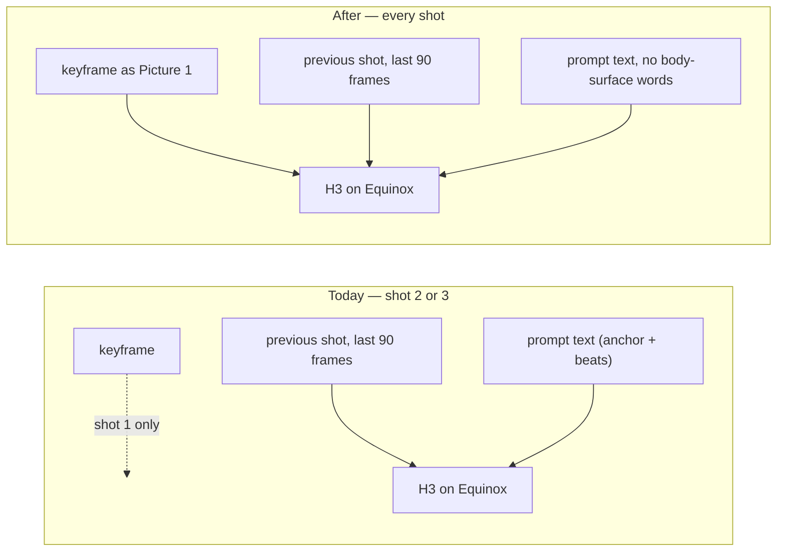
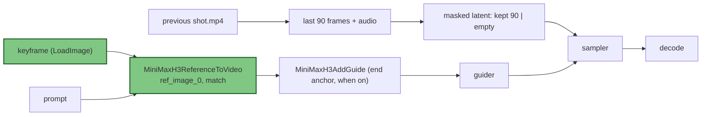
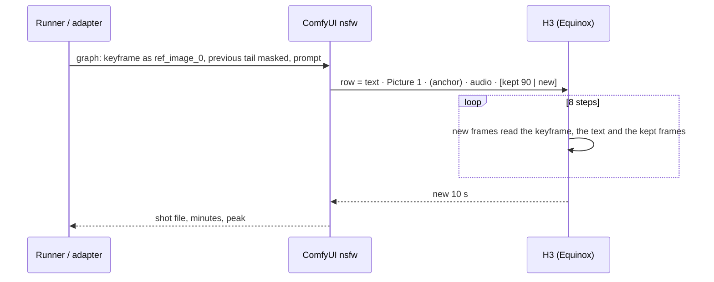

# EPIC_014 — The keyframe in every shot

**Status:** Proposed (2026-10-29 11:45 EDT — the owner, after the hunk Take 4 redraw proved the wording was not the cause: "Please create the epic to add Ref2Video support. Remember we are just using images for this release.. video potentially in another release. To see if it works we will retry shot 3 of the hunk scene without using wording mentioning there is no chest hair because the ref2video support should already do that naturally for us")
**Started:** 2026-10-29 12:08 EDT (the owner's go on STORY_081, by the tool)
**Scope decided by the owner (2026-10-29):** reference **images** only. Reference videos are [BACKLOG_017](../backlog/BACKLOG_017_video_references_in_a_shot.md), another release. The assistant director's round is paused for this epic (straw `run.log`, 15:37 UTC).
**Decisions of 2026-10-29 12:00 (the owner, by the tool):** all stories drafted now, in implementation order; the prompt names the picture per the research in STORY_081 (name it once at first appearance, never with the first-frame alignment line; the guide's header as row 2); if Eros Max shows no difference, **one row on PinkCherry** before calling it a dead end; **this epic takes priority over the weekend rule** — 082 and 083 are built Friday 2026-10-30.
**Supersedes:** [SPIKE_005](../spike/SPIKE_005_a_reference_image_in_every_shot.md) — its desk half is done ([the Ref2VA reading](../spike/SPIKE_005_ref2va_readme.md)); its experiment is STORY_081's manual verification. Related: [BACKLOG_016](../backlog/BACKLOG_016_hold_the_face_in_back_shots.md) (the face in back shots — the same mechanism; this epic's answer settles it).

## Goal

Every shot of a scene is drawn while the model can see the scene's keyframe — not only shot 1, which starts from it, but shots 2 and 3, which today see only the previous 3.75 s of footage and the words. A body part that leaves the frame (his chest when he turns his back, his face in a back scene) comes back from the picture instead of from the anchor text. After this epic a round's runner, the adapter and the composer all pass the keyframe to every shot as a **reference picture** (`MiniMaxH3ReferenceToVideo`, `<Picture 1>`), the prompts stop carrying body-surface words the picture already carries, and the cost per shot is known in minutes.

**The first thing the epic does is the owner's test:** shot 3 of hunk scene 2 Take 4 (seed 926611381) is redrawn a third time — the same shots 1–2, the keyframe as a reference, and **no words about his chest hair either way**. The chest at the turn (≈ 27–31 s) decides whether the rest of the epic is built.

## What exists today (read from the code and the box, 2026-10-29 10:40–11:40 EDT)

- **The failure, measured.** Hunk scene 2 Take 4: the keyframe (`keyframes/scene-2.png`, 1344×768) shows smooth pecs with a light patch below the breastbone and a light trail down the abs. Shot 1 kept it while he faced the camera (0–7 s); he turned his back; shot 2 is back-only; shot 3 drew a hairy chest when he turned round at ≈ 28 s. The prompts' anchor said "dark hair across his chest and down his abs" (the assistant's words, not in the owner's scripts). **The redraw of shot 3 with the corrected anchor ("a smooth chest with only a light trail…"), the same seed and the same shots 1–2 landed at 11:16 EDT with the same hairy chest at the turn, almost pixel for pixel.** The wording is not the lever; the missing picture is. The assistant director saw the same.
- **How a shot is drawn.** Shot 1: `MiniMaxH3ImageToVideo` with `first_frame` = the keyframe (`tools/rounds/template/graph.py`; the adapter's `buildGraph`, `spark/adapter/src/mapping.ts`). Shots 2–3: `extend.py` calls the adapter's own `buildGraph` inside the adapter container with a `continuation` — the previous shot's last 90 frames written into the new clip's latent under a noise mask, text-only conditioning (`cond` = `MiniMaxH3ImageToVideo` with no frames), the end anchor (`MiniMaxH3AddGuide`) off since 2026-10-10 on Equinox. Measured on 40 jobs 10-28/29: **shot 1 = 22.0 min, an extension = 38.2 min, a take = 98.4 min** (±0.4).
- **The reference node is in the container and unused.** `comfy_extras/nodes_minimax_h3.py:241–363`, `MiniMaxH3ReferenceToVideo`: `clip`, `prompt`, `width`, `height`, `length`, `ref_image_size` (`match` | `max`), up to 9 `ref_images`. The conditioning carries `minimax_refs` beside `minimax_keyframes`; `comfy/model_base.py:2186–2197` merges both; `comfy/ldm/minimax/model.py:367–377` places references before the clip's timeline and counts keyframe times from after them, so the end anchor still lands on the last frame. The masked prefix lives in the latent, not the conditioning, so **a reference, the 90 kept frames and the end anchor can share one graph** — legal in the code, drawn by no one yet. Full attention, no mask (`model.py:199`): the new frames read the reference at every one of the 8 steps. Our keyframes are ≤ 1376 px wide and `max` never scales up, so `match` and `max` are the same for us.
- **The checkpoint question is open.** Our stack is `10Eros_Max_h3_TURBO-hybrid_beta5_int8` (Equinox: + HMPenis v2 0.45 + Male_Anatomy v2.02 0.4, 8 steps). Its creator labels it a *hybrid FL2VA/Ref2VA* merge; whether it follows reference tokens is **unproven**. Fallbacks on disk: `pinkcherryMMH3Fl2va_v15Fl2vaRef2va_int8` (21 GB, NSFW, an FL2VA + Ref2VA merge) and the official `minimax_h3_ref2va_int8_convrot` (34 GB, SFW).
- **The contract has no place for it.** `docs/contracts/job-api.md` v1.6: `referenceImage` (0–2 multipart parts) means FL2VA's first/last frame, and an extension refuses it ("the video being extended is the reference", `capabilities.ts:135`, the stub's `server.ts:214`, the app's `submit-job.ts:46`). `REQUIRED_CLASSES` lacks `MiniMaxH3ReferenceToVideo`; `/health` already reports whether the Ref2VA file is present (`server.ts:315–331`). Adapter 1.7.0.
- **The skill writes shots 2–3 with no picture reference** (`.claude/skills/minimax-h3-i2v-amg-scene/SKILL.md:58, 203`: "shots 2 and 3 drop `in <Picture 1>`"), and the anchor describes the man by appearance (build, hair, face, skin) — the rule that let "dark hair across his chest" in.
- **The hunk scene 2 keyframe is already in the NSFW container's input** as `hunk/scene-2.png` (`image.txt`), the name `LoadImage` takes. The corrected-wording shot 3 is now `output-nsfw/video/nsfw-B-3-926611381_00001_.mp4`; the original is in `hunk-T4-orig/`. `chain.sh` resumes an existing segment, so a third draw must move the second aside first (the same step as this morning's).

## Architecture

### A shot's inputs, today and after

### The graph change (one node swapped, everything else the same)

| Piece | Ticket | What changes | What does not |
| --- | --- | --- | --- |
| The round runner | 081 | `extend.py` (and `graph.py`) take `--ref-image <input name>`; `ext-standalone.sh` / `chain.sh` pass the scene's keyframe (`REF_IMAGE`, default on once 081's verification says so) | the masked prefix, the LoRA chain, the join, the measures |
| The adapter | 082 | contract **v1.7**: one `subjectImage` part on a fresh job **or an extension**; `buildGraph` builds the reference conditioning (first/last frames through `MiniMaxH3AddGuide` at 0 / L−1, since the reference node has no `first_frame`); `capabilities.subjectImage`; the stub accepts and records it; adapter 1.8.0 | `referenceImage` (first/last frame) as it is; the SFW path byte for byte |
| The composer | 083 | a chain's extensions carry the photo as the subject picture (*Hold him from the photo*, default on with a photo attached); the Extend flow offers it for a finished video | single clips without a photo; the raw-scripts path |
| The skill | CHORE_065 | shots 2–3 name `<Picture 1>` in the camera sentence; the anchor drops body-surface attributes the picture carries — **the words decided by 081's result**, not in advance | the beats, the blocking, the shot list |

### A shot, after this epic

## Definition of Done (the epic)

- **The owner's test is answered in writing:** hunk scene 2 Take 4 shot 3, third draw — the keyframe as a reference, the same seed and shots 1–2, the anchor with no chest-hair words either way — with the chest at the turn beside the keyframe, the original and the corrected-wording draw, the minutes against 38.2 and the peak memory. Whatever the answer, it is in STORY_081's Done note with the date.
- If the picture holds him: 082 and 083 Done with their gates green and one real round of **three takes** drawn on the Spark with the keyframe in every shot (Equinox), a full-resolution body check at the end of every shot (chest hair, moles, face, accessories) recorded per take, and the minutes per shot in the Done note. If it does not: the epic closes at 081 with a chore recording the dead end and which checkpoint it was tried on, and BACKLOG_016 is updated.
- The SFW path is byte for byte what it was; every existing spec stays green; `extend.spec.ts` and `composer.spec.ts` cover the "unchanged" halves.
- README › Running the Model documents the subject picture, the field, the cost per shot and `match`; the contract is at v1.7; the skill's build is bumped.

## Risks and what catches them

| Risk | Where it would show | What catches it |
| --- | --- | --- |
| Eros Max ignores reference tokens (plain FL2VA weights never saw a clean picture before the clip) | 081: no difference at the turn with vs without | the same seed drawn both ways; then one row on PinkCherry (an FL2VA + Ref2VA merge) before calling it a dead end; the official Ref2VA file is SFW and not a row |
| He snaps back toward the keyframe's pose or framing mid-shot (MiniMax's guide: a reference can justify a cut) | 081: a jump in the middle of shot 3 | the 4 fps check of the shot's middle and the shot-change measure; `JOIN_MIN` on the joins; a `partially_preserved` / crop-of-the-torso row if it happens |
| HMPenis and Male_Anatomy misbehave with references on (both trained on FL2VA) | 081's anatomy check | the full-resolution waist-to-knees check on every nude beat; a fault here is a cancel per the rounds' rules |
| The combined graph fails ComfyUI's validation | 081's first second | `--no-post --dump` dry run first; the dangling-reference check `extend.py` already has |
| A slower code path (a memory spill, another attention kernel) | 081's minutes | the estimate is +1.4 min per extension (≈ +4%); anything beyond +3 min is investigated before 082 |
| A clothed keyframe (scene 1) fights the undressing beats | a scene 1 round after 083 | 083 keeps the toggle per chain; CHORE_065 words scene 1 `partially_preserved` if the data says so; the back scene's nude keyframe has no such problem |
| The gate cannot see the model | every lane | the stub records the `subjectImage` part and the e2e asserts it was received (§ 6b); the identity check is the manual verification, dated, per story |
| The contract version collides with EPIC_011's STORY_064 (drafted as v1.6, which STORY_080 took) | whichever lands first | v1.7 goes to the first to land; the other renumbers before its code (the pact of 2026-09-19) |

## Time

| | |
| --- | --- |
| **Estimate to completion** | ≈ 8 h 15 min — 081 ≈ 2 h (≈ 1 h desk: the flags, the dry run, the prompt variant, moving the second shot 3 aside; ≈ 40 min GPU; ≈ 20 min the comparison and the note), 082 ≈ 3 h, 083 ≈ 2 h 30 min, CHORE_065 ≈ 45 min |
| **Basis** | EPIC_010/011's measured pace (a Medium story ≈ 2 h 15 min from approval to Done, a Large ≈ 3 h, a gate ≈ 8–9 min); the extension's 38.2 min measured on 40 jobs this week; the Spark idle now (the AD's round stopped 11:37 EDT) |
| **Estimated completion** | 081 **today**: a go by 12:30 EDT → row 1 lands ≈ 13:30, the answer by **≈ 14:00 EDT** (≈ 15:30 if rows 2 and 3 are needed). If it holds: **Friday 2026-10-30** (the owner's call, over the weekend rule) — 082 by ≈ 13:00, 083 by ≈ 16:30, CHORE_065 by ≈ 17:30 EDT |
| **Actual completion** | — |

## Stories (in implementation order)

| # | Ticket | Status | Estimate | Started | Estimated done | Actual done |
| --- | --- | --- | --- | --- | --- | --- |
| 081 | [**The runner sends the keyframe**](../story/STORY_081_the_runner_sends_the_keyframe.md) — `extend.py` gains `--ref-image`; `ext-standalone.sh` / `chain.sh` pass the scene's keyframe (`REF=1`, default off); the dry-run graph diff. **Manual verification = the owner's test:** hunk scene 2 Take 4 shot 3, seed 926611381, shots 1–2 kept, `hunk/scene-2.png` as `<Picture 1>` named once at first appearance, the hair clause deleted; rows 1 → 2 (the guide's header) → 3 (PinkCherry) until one holds; the chest at the turn beside the keyframe and the two earlier draws; minutes and peak | **Implemented — row 1 held** (rows 2–3 not needed); Done on the push | ≈ 2 h (to 3 h 30 min with rows 2–3) | 12:08 EDT | today ≈ 14:00 EDT | **12:50 EDT** (41.1 min vs 38.5 without the picture: +2.6 min per extension) |
| 082 | [**The adapter's reference picture**](../story/STORY_082_the_adapters_reference_picture.md) — contract v1.7: one `subjectImage` part on fresh jobs and extensions; `buildGraph` with `MiniMaxH3ReferenceToVideo` (+ `AddGuide` for first/last frames); `capabilities.subjectImage`; the stub mirrors it; `prompt.ts` names the picture and passes `subject_definitions:` through; adapter 1.8.0 | Proposed (after 081's yes) | ≈ 3 h | — | Fri 10-30 ≈ 13:00 | — |
| 083 | [**The chain carries his picture**](../story/STORY_083_the_chain_carries_his_picture.md) — the composer's *Subject* group (*Him, from the photo* by default); chains send the photo on every segment; Extend mode resolves the chain's photo on the server; e2e: the stub received it on both segments | Proposed (after 082) | ≈ 2 h 30 min | — | Fri 10-30 ≈ 16:30 | — |
| C065 | [**The skill names the picture**](../chore/CHORE_065_the_skill_names_the_picture.md) — shots 2–3 carry the winning row's picture reference; the anchor drops body-surface words; the words from 081's data; build bumped | Proposed (after 081's data) | ≈ 45 min | — | Fri 10-30 ≈ 17:30 | — |

The order is the dependency order: 081 first because it is the owner's test and needs no product code (the runner builds its graph through the adapter's own `buildGraph` for the continuation, then rewires — the reference is a swap of the `cond` node in that rewiring, the same way the LoRA chain is); 082 before 083 (the UI is built on a contract the integration lane proves against the stub); the chore last, from the data. **Story numbers 081–084 are reserved for this epic** (072–079 are EPIC_012/013's; 080 is landed); the chore takes the next free chore number when drafted.

## Later, not in this epic

- **Reference videos** — [BACKLOG_017](../backlog/BACKLOG_017_video_references_in_a_shot.md): up to 3 clips of 2–15 s; a 124-frame clip measured 2.7× the step time in September (STORY_016); another release, the owner's decision 2026-10-29.
- **Shot 1 with the reference too** — shot 1 already starts from the keyframe; whether a reference on top helps the end of shot 1 (he has turned by ≈ 7 s) is a row after 081, not before.
- **`max` sizing** — only matters for keyframes above 768p; ours are not. A row if the keyframes ever are.
- **A torso crop as a second reference** — if the whole keyframe pulls him back toward its pose, a crop of the chest and face as `<Picture 2>`; ≈ +1.4 min more per shot.
- **The face in back shots** ([BACKLOG_016](../backlog/BACKLOG_016_hold_the_face_in_back_shots.md)) — closed or re-planned from this epic's answer; no separate spike.

## Rules that apply

- **No story is built before its approval**, and one at a time (CLAUDE.md § 3, § 6.5). The epic's approval is not a story's; 081's draw waits for the owner's go.
- **The gate never touches the model.** Every lane runs against the stub; the identity check is a manual verification in the Done note with the date, the seed, the checkpoint, the LoRAs and the minutes (§ 3.5, § 4a).
- **The SFW path is untouched** (EPIC_010 › Rules): `h3_t2v_prompt.json`, the `comfyui` service and `run.sh`'s default path do not change in any story here.
- **The experiment is one variable at a time.** The owner's test changes two things against the corrected-wording draw (the picture in, the hair words out) on purpose — that is the product question. The rows that follow change one thing each: the prompt's form (row 2), then the checkpoint (row 3). If row 1 holds, an attribution row (the picture in, the smooth-chest words left in) is the owner's option before 082.
- **Anatomy and body words stay the owner's** (`no-genital-wording-of-mine`, `scripts-name-the-man-not-things`): the reference removes words from the prompts; it never adds any.
- **The owner's photos, scripts and prompts are his.** Fixtures in the repo are SFW stand-ins; nothing from a round is committed; `test/` stays untracked.
- **Weights are precious.** PinkCherry is already on disk; no fetch or move in this epic without the owner's say-so in the session.
