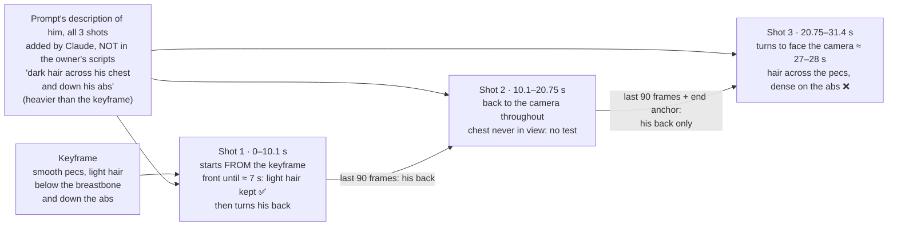
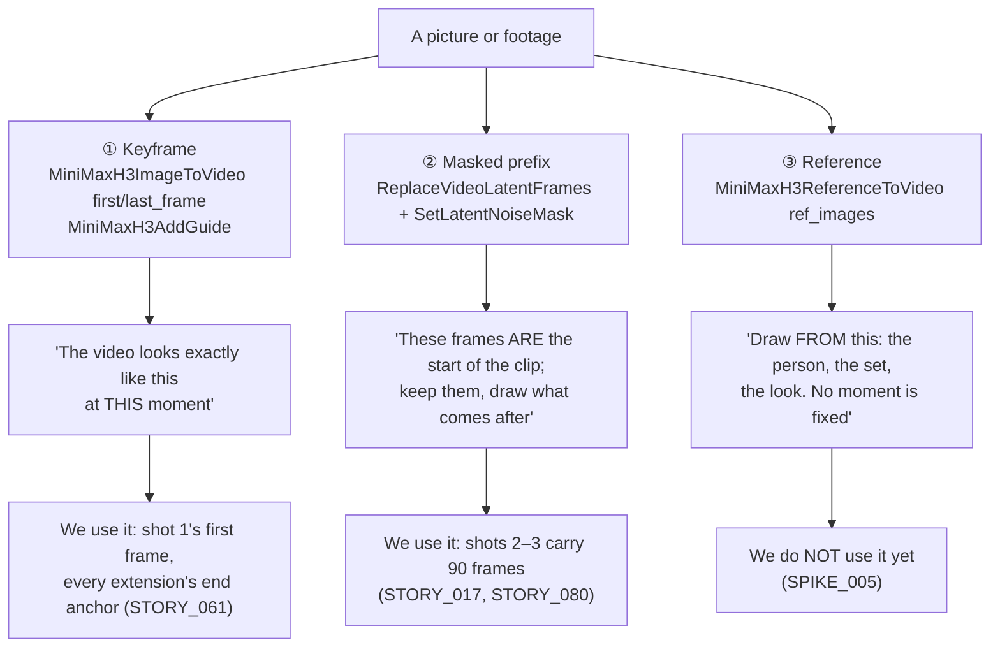
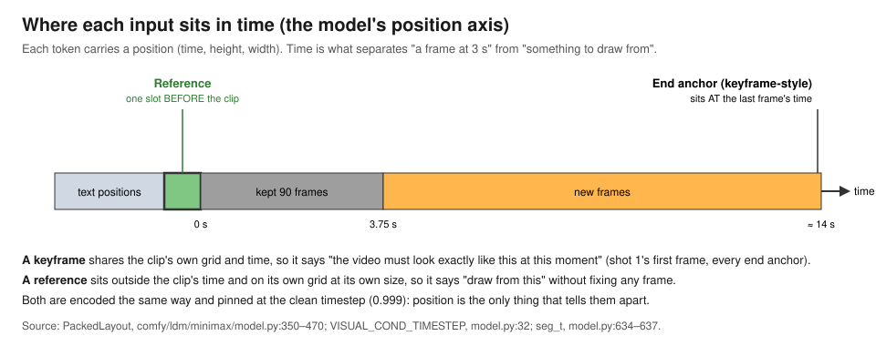
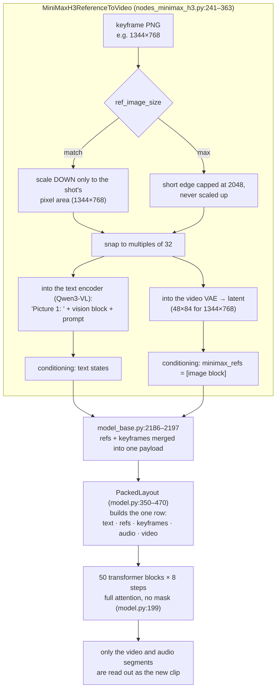
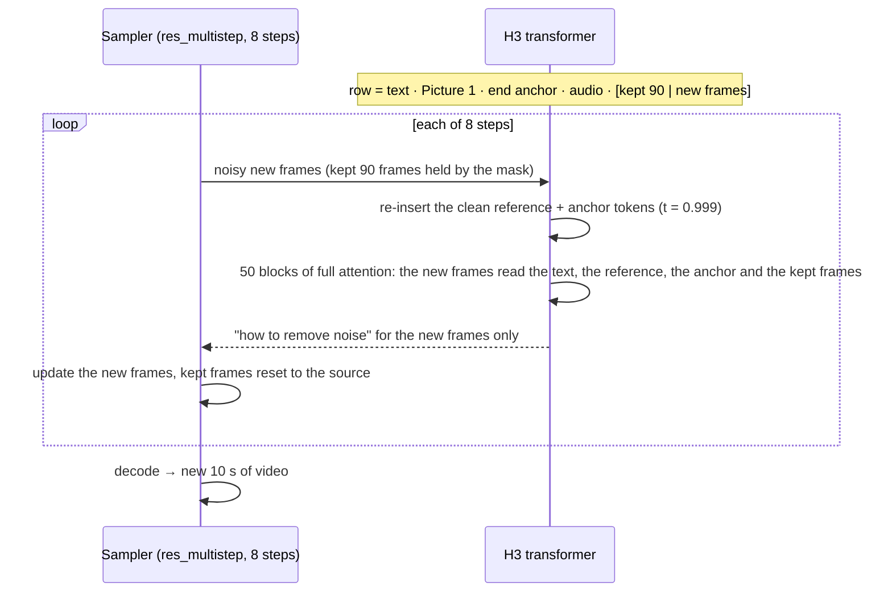
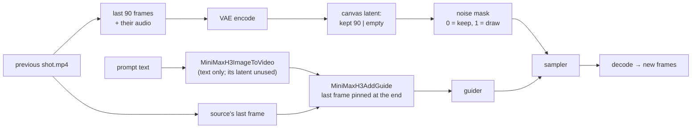
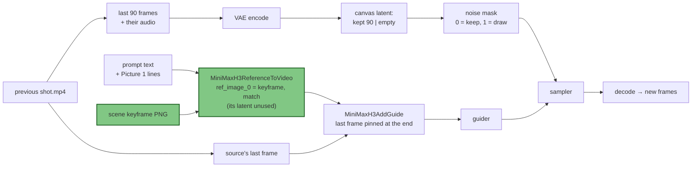
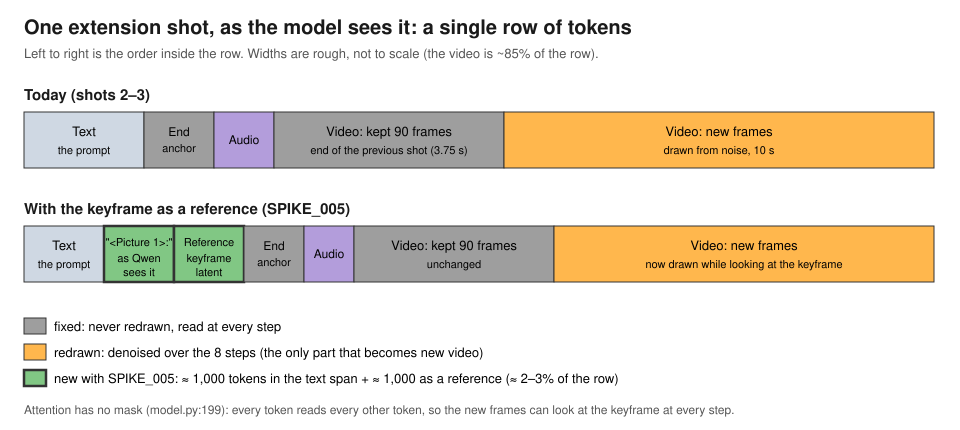
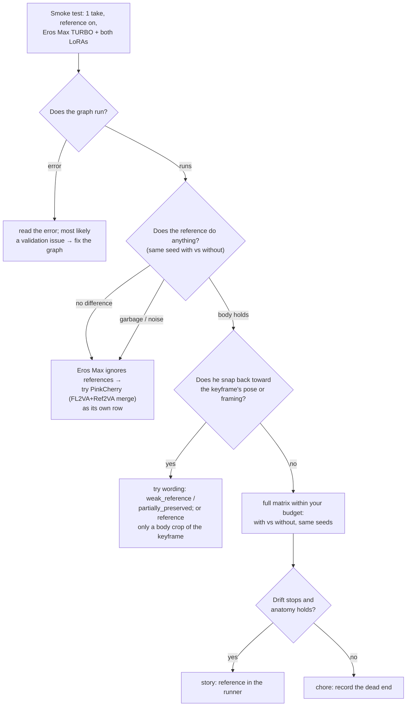

# How MiniMax H3 handles reference images (Ref2VA)

Background reading for [SPIKE_005](SPIKE_005_a_reference_image_in_every_shot.md). Written 2026-10-29 from the node and model source in the running `minimax-comfyui-nsfw` container (ComfyUI v0.35.1), MiniMax's model card and its reference prompt guide. **Nothing here has been drawn on the Spark yet.** Each claim is marked **read** (from code or docs), **measured** (on our box) or **estimate** (arithmetic).

> **Figures.** There are nine, numbered by section (Figure 2.1 is the first figure in §2). Seven are Mermaid diagrams and two are pictures. See the [list of figures](#list-of-figures).
>
> The diagrams are Mermaid. GitHub renders them. In VS Code's preview they need the "Markdown Preview Mermaid Support" extension, or else they show as code blocks. The two pictures are SVG files in [SPIKE_005_img/](SPIKE_005_img/).

---

## List of figures

| Figure | Section | Shows |
|---|---|---|
| 2.1 | §2 | What hunk scene 2, Take 4 was shown, shot by shot |
| 3.1 | §3 | The three ways a picture can enter a generation, and where we use each one today |
| 3.2 | §3 | Where each input sits on the model's time axis |
| 4.1 | §4 | A reference image's path through the code, from the PNG to the transformer (file and line in each box) |
| 5.1 | §5 | One sampling step with the reference in the row; the loop repeats 8 times |
| 6.1 | §6 | Today's graph for shots 2–3, as built by the adapter (spark/adapter/src/mapping.ts) |
| 6.2 | §6 | The SPIKE_005 graph for shots 2–3 |
| 6.3 | §6 | One extension shot as a row of tokens, today (top) and with the keyframe as a reference (bottom) |
| 8.1 | §8 | The experiment's decision path, from the smoke test to a story or a chore |

---

## 1. The short version

> **Scope (owner, 2026-10-29):** SPIKE_005 uses reference **images** only. Reference videos (`ref_videos`, §3 and §7) are described here for background and are out of scope for now; they wait in [BACKLOG_017](../backlog/BACKLOG_017_video_references_in_a_shot.md).

| Question | Answer | How we know |
|---|---|---|
| Does MiniMax support reference images? | Yes. "Ref2VA" (*omni-reference mode*) takes up to 9 images, 3 videos and 3 audio clips, named `<Picture 1>`, `<Video 1>` and `<Audio 1>` in the prompt | read: model card, line 75 |
| Is it the same model we run? | No. MiniMax ships two weight sets: **FL2VA** (text plus first and/or last frame; ours) and **Ref2VA** (references) | read: model card, lines 74–75 and 178–179 |
| Does our checkpoint understand references? | Unknown. Its creator calls Eros Max a *hybrid FL2VA/Ref2VA* merge, but no one has tested it | read: SPIKE_001, line 193 |
| Can a reference ride with our 90-frame extensions? | In the code, yes. It is a separate input from the carried-over frames and the end anchor | read: code (§6, Figures 6.1–6.3) |
| What would it cost? | **Measured 2026-10-29: +2.6 min per extension** (41.1 vs 38.5 min, the same job with and without the picture), peak 68.9 GiB; the §7 estimate was +1.4 | measured (STORY_081 row 1) |
| `match` or `max`? | For us they are almost the same, because our keyframes are already ~1344×768 and `max` never scales up | read: code, plus our keyframe sizes |

---

## 2. Why we care: the failure SPIKE_005 is about

Hunk scene 2, Take 4 (seed 926611381), traced in Figure 2.1 from the original 31.4 s film (`output-nsfw/video/hunk-T4-orig/hunk-B-926611381.mp4`, 753 frames = 243 + 255 + 255), checked frame by frame on 2026-10-29.

- **The keyframe** has smooth pecs with a light patch of hair below the breastbone and a light trail down the abs.
- **The anchor**, the description of him at the top of all three original MiniMax prompts (written 10-24/25), said "a heavy square chest, dark hair across his chest and down his abs". That's heavier than the keyframe. **The phrase is not in the owner's scripts** (`scenes/scene-2/shot-1..3.txt` never mention hair or the chest). I added it when converting the scripts to prompts, and didn't list it as an added attribute for the owner's OK. The redraw of shot 3 on 10-29 changed it to "a smooth chest with only a light trail of dark hair down the centre of his abs".



*Figure 2.1. What hunk scene 2, Take 4 was shown, shot by shot: from about 7 s to 27 s nothing in any shot's input shows his chest. At the turn the chest comes back hairy, with the wrong wording AND with the corrected wording (the redraw, §2).*

The keyframe only enters shot 1. After he turns his back at about 7 s, his chest is out of view for about 20 s. Shot 3's inputs (shot 2's last 90 frames and its end anchor, shot 2's last frame) show only his back. When he turns around at about 28 s, nothing the model is given shows his chest.

**The wording was not the cause** (tested 2026-10-29). Shot 3 was redrawn at 10:38 ET with the corrected wording ("a smooth chest with only a light trail of dark hair down the centre of his abs"), the same seed and the same shots 1–2. It landed at 11:16 ET with the same hairy chest at the turn, almost pixel for pixel. Changing the phrase made no visible difference: the model draws the chest itself once the keyframe is out of view. A correct anchor is still needed, but it isn't enough. That is the gap a reference image would close.

The moles that appear only on the back (straw scene 2, 4 of 4 shot 2s) look like the same mechanism, a body part the model hasn't been shown recently. I haven't checked those frames.

**The idea:** put the keyframe in front of every shot as "this is what he looks like". Then a body part that goes off screen comes back from the picture, not from the words.

**The result (2026-10-29 12:50 ET, STORY_081 row 1).** Shot 3 drawn a third time — same seed, same shots 1–2, the keyframe as `<Picture 1>` named once in the prompt, no chest-hair words either way — came back with **the keyframe's chest** at the turn: smooth pecs, the light central trail. Eros Max TURBO follows the reference. The turn, the anatomy, the face and the join were unaffected; the shot took 41.1 min against 38.5 without the picture. The rest of this document is the reasoning that led there; [EPIC_014](../epic/EPIC_014_the_keyframe_in_every_shot.md) is what happens next.

---

## 3. The three ways a picture can enter a generation

H3 is a single transformer that reads **one long row of tokens**: the prompt, then any pictures, then the audio, then the video being drawn. Where a picture sits in that row, and what time it is labelled with, decides what it does (Figure 3.1).



*Figure 3.1. The three ways a picture can enter a generation, and where we use each one today.*

| | Keyframe | Masked prefix | Reference |
|---|---|---|---|
| Where in the row | its own tokens, right after the text | inside the video itself | its own tokens, right after the text |
| Its time label | the frame's moment in the clip | its own frames' moments | one slot **before** the clip starts |
| Its size | stretched to the clip's grid | the clip's grid | its own size and shape |
| Redrawn? | never | never (mask 0) | never |
| What it means | "hit this frame" | "this already happened" | "draw from this" |
| Weights trained on it | FL2VA | none; a ComfyUI trick (PR #15375) that works on FL2VA | **Ref2VA** |



*Figure 3.2. Where each input sits on the model's time axis: the reference sits one slot before the clip, the end anchor at its last frame.*

**The key detail** *(read: model.py:634–637; Figure 3.2)*: keyframe tokens and reference tokens are encoded the same way. Both go through the same VAE, use the same video tag and are pinned at the same "clean" timestep (0.999). **The only differences are their time position and grid** (and the "Picture 1:" label the text encoder sees). A model that was trained on references has learned that "a clean picture one slot before the clip" means identity. A model that never saw one, like plain FL2VA, has no learned meaning for it. That is the heart of the open question in §8.

---

## 4. How a reference image travels through the code



*Figure 4.1. A reference image's path through the code, from the PNG to the transformer (file and line in each box).*

Step by step, following Figure 4.1 from top to bottom:

1. **Resize** *(read: nodes_minimax_h3.py:295–311)*. `match` scales the image down, keeping its shape, until it has the shot's pixel area. `max` caps the short edge at 2048 and never scales up.
   - **For us:** the current keyframes are 1344×768, 1376×768 and 1376×786. Under `max` they stay the same size (all far below 2048), and under `match` they shrink by 0–4%. **So `max` buys us nothing.** It only matters for keyframes larger than 768p. *(read: our files, 2026-10-29)*
2. **The text encoder sees it** *(read: text_encoders/minimax.py:1–20, 169–)*. Qwen3-VL receives `Picture 1: ` + the image's vision tokens + our prompt. That is how the words "the man in `<Picture 1>`" get attached to this image.
3. **The VAE encodes it** into a one-frame latent. That becomes a "reference block" of about 1,000 tokens.
4. **The row is built** *(read: model.py:367–470)*. References go right after the text, each taking one time slot. The clip's own timeline starts after them, and keyframe times are counted from there, so the end anchor still lands on the last frame.
5. **Every step, every block, every token reads every other token** *(read: model.py:199, `mask=None`)*. The new frames can look at the reference at all 50 blocks of all 8 steps.
6. **It is never redrawn** *(read: model.py:405–408)*. Reference tokens are flagged "do not update" and re-inserted clean at every step. Only the video and audio segments are written out.

---

## 5. What a single sampling step looks like



*Figure 5.1. One sampling step with the reference in the row; the loop repeats 8 times.*

Figure 5.1 is why the cost is *per step*. The reference is not "used once at the start". It is read at every step, which is also why it can hold the body to the end of the shot.

---

## 6. Can it ride with our extensions?

### Today's graph for shots 2–3 *(read: spark/adapter/src/mapping.ts, continuation branch)*



*Figure 6.1. Today's graph for shots 2–3, as built by the adapter (spark/adapter/src/mapping.ts).*

### The SPIKE_005 graph: one node swapped, everything else the same



*Figure 6.2. The SPIKE_005 graph for shots 2–3. Green marks the only new parts: the keyframe input and the swapped conditioning node.*



*Figure 6.3. One extension shot as a row of tokens, today (top) and with the keyframe as a reference (bottom).*

Going from Figure 6.1 to Figure 6.2 swaps one node. Figure 6.3 shows what that adds to the row. Why the code allows it *(read)*:

- **The carried-over frames live in the latent, not the conditioning.** The extension already ignores the conditioning node's own empty latent. Swapping that node doesn't touch the 90 frames.
- **References and anchors are separate lists** (`minimax_refs`, `minimax_keyframes`), and `model_base.py:2186–2197` merges both into one payload. `MiniMaxH3AddGuide` appends to whatever conditioning it's given.
- **Positions stay consistent.** `PackedLayout` advances the clip's start past the reference slots *before* placing keyframes (`model.py:367–377`), so "the last frame" is still the last frame.
- **Shot 1 can take it too.** It would be `MiniMaxH3ReferenceToVideo` for the reference plus `MiniMaxH3AddGuide` at frame 0 for the first frame, since the reference node has no `first_frame` input. Whether shot 1 needs it at all is a spike question, because shot 1 already starts from the keyframe.

What the code **cannot** tell us is in §8.

---

## 7. What it costs in minutes

### What a take costs today (measured)

From ComfyUI's own history on the Spark: 40 jobs between 10-28 13:36 and 10-29 09:53 EDT (hunk and the back scene). All were Eros Max TURBO, 8 steps, 1344×768, with both LoRAs.

| Job | Frames | Minutes (range) | Typical |
|---|---|---|---|
| Shot 1 | 243 | 21.6–22.3 | **22.0** |
| Shot 2 or 3 (extension) | 345 | 37.9–38.6 | **38.2** |
| **A 3-shot take** | | | **98.4 (1 h 38 min)** |

The times barely vary (±0.4 min), so a difference of a minute or more with the reference on will show clearly in one run.

### Why time grows faster than length

Each job's time is mostly the transformer reading its row of tokens, 8 steps × 50 blocks:

- The **linear part** (each token through the layer's weights) grows with the number of tokens, N.
- The **attention part** (every token reading every other token) grows with N².

Fitting `minutes = a·N + b·N²` to the two measured job sizes (N in thousands of tokens) gives:

| | Shot 1 | Extension |
|---|---|---|
| Video tokens | 61 latent frames × 1,008 = 61,500 | 87 × 1,008 = 87,700 |
| Plus: text (≈ 1,500), audio, keyframe or anchor (1,008), Qwen's view of the first frame (1,008, shot 1 only) | ≈ 4,300 | ≈ 3,700 |
| **N** | **≈ 65,800** | **≈ 91,400** |
| Measured | 22.0 min | 38.2 min |

→ **a = 0.119, b = 0.00327**, so `minutes ≈ 0.119·N + 0.00327·N²`.

Two checks that the formula is sound:

1. **The split matches the model's arithmetic.** In an extension it puts 27 of the 38 minutes (71%) in attention. Counting FLOPs from the model's dimensions (hidden 5,376, FFN 14,336) gives about 74% attention per layer at 91k tokens.
2. **It predicts September's measurement.** STORY_016's extension was 277 frames plus a 124-frame reference video, a 22-frame guide and Qwen's view of the video, about 115,000 tokens in all. The formula gives 0.119·115 + 0.00327·115² ≈ 57 min against a 22.0 min fresh clip: **2.6×**. On 2026-09-13 we measured **2.7×**. So the formula explains the one reference run we have.

### With the keyframe as a reference

One reference image at `match` adds about **2,000 tokens** (the two green blocks in Figure 6.3): ≈ 1,000 in the video model (one latent frame) and ≈ 1,000 in the text span (Qwen's vision tokens, 84 × 48 patches merged 2×2). Encoding one image through Qwen and the VAE adds a few seconds on top.

| Job | Today (measured) | With the reference (estimate) | Extra |
|---|---|---|---|
| Shot 1 | 22.0 min | **23.1 min** | **+1.1 min** |
| Shot 2 | 38.2 min | **39.6 min** | **+1.4 min** |
| Shot 3 | 38.2 min | **39.6 min** | **+1.4 min** |
| **A 3-shot take** | **98.4 min** | **≈ 102.3 min** | **≈ +4 min (+4%)** |
| A night of 12 takes | ≈ 19 h 41 min | ≈ 20 h 28 min | ≈ +47 min (about half a take) |
| SPIKE_005's proposed 6 takes (3 with, 3 without) | | | ≈ +12 min total |

Variants, with the same formula:

| Variant | Extra per take |
|---|---|
| Reference only in shots 2–3 (shot 1 already starts from the keyframe) | ≈ +2.8 min |
| Two references (keyframe plus a body crop) | ≈ +8 min |
| `max` instead of `match` | ≈ +0 for our 1344×768 keyframes (`max` never scales up) |

**How firm this is.** The baseline is measured. The extra is a prediction from a formula that matches both the model's FLOP split and the September measurement. The real risk is not the token count: if the combined graph takes a slower code path (a memory spill or a different attention kernel), it would show as a jump well beyond +1.4 min on the first extension. The smoke test's ComfyUI clock settles it in one take.

Memory follows tokens almost linearly: about +2% on the ≈ 57 GB peak, so roughly +1 GB of the Spark's 121 GB.

---

## 8. What the code cannot answer (the experiment)

Figure 8.1 is the plan: each question below is a branch in it.



*Figure 8.1. The experiment's decision path, from the smoke test to a story or a chore.*

| Unknown | Why it matters | What would show it |
|---|---|---|
| **Does Eros Max follow reference tokens?** | Plain FL2VA weights never saw a clean picture one slot before the clip. They may ignore it, or misread it as a keyframe and try to hit it | Same seed, with vs without: is there any difference, and is it a good one? |
| **Do HMPenis and Male Anatomy still hold?** | Both were trained on FL2VA. SPIKE_001 set aside the Ref2VA-only LoRAs for that reason | The full-resolution anatomy check on every nude beat |
| **Does he snap back to the keyframe's pose?** | MiniMax's guide says a reference can justify a new shot. With 90 frames kept and the end anchor pinned, a cut can only show up mid-shot as a jump toward the keyframe | 4 fps check of each shot's middle; the shot-change measure |
| **Does the combined graph run?** | A reference, a masked prefix and an end guide together is legal in the code, but no one documents it | The smoke test's first second |
| **Does it fix what we care about?** | Chest hair, moles, face and accessories at the end of each shot | The body check SPIKE_005's ACs list |

**Why STORY_016 doesn't answer this.** In September we used the official Ref2VA checkpoint with the *previous footage* as a reference **video**, and got a cut to a new set at the seam plus 2.7× the step time. That was a **continuity** question, and the reference was the thing that had to continue. Here, continuity stays with the 90 kept frames, and the still image only guards **identity**. It's a different job, so the September result points neither way.

---

## 9. How the prompt names the reference

MiniMax's [reference prompt guide](../references/prompt-guides/VIDEO_PROMPT_WRITING_GUIDE_ref_en.md) has its own vocabulary. The three pieces that matter here:

**Task type** (§3, lines 130–141):

| Task type | Meaning | For us? |
|---|---|---|
| `keyframe completion` | the image *is* a frame (first, last, a keyframe) | no: it would pin his pose |
| `reference generation` | the image guides a character or set "without serving as a concrete frame" | **yes** |
| `video continuation` | new content continues a source video | yes, for shots 2–3, combined: `[video continuation + reference generation]` |

**Define him once as a subject** (§2.1, lines 51 and 68). When an image only defines a person, the guide says to cite it *inside* a subject definition and not as a standalone picture entry:

```text
<Subject 1> is the man in <Picture 1>, …
```

**Say how strictly to keep him** (§4.1):

| Marker | Meaning |
|---|---|
| `fully_preserved` | keep exactly what the reference defines (his body as pictured) |
| `partially_preserved` | keep it, but some traits change |
| `attribute_transfer` | move traits to a different subject |
| `weak_reference` | only broad similarity |

```text
<Subject 1> (appears in [Shot 1]): fully_preserved - …
```

Two cautions for when the skill learns this:

- **The reference shows him dressed or naked, as the keyframe is.** For a scene whose keyframe is clothed, "keep his body like `<Picture 1>`" could fight the undressing beats. The nude scene's keyframe (scene 2) has no such problem. Scene 1 might need `partially_preserved`, or a reference of the face and chest only. That's an experiment row, not a guess to bake in.
- **Words still matter.** The anchor-from-a-crop rule (CHORE_048) stays. The reference is a safety net under a correct anchor, not a replacement for one.

---

## 10. What's on the box (2026-10-29)

| File | Size | Role | Reference support |
|---|---|---|---|
| `10Eros_Max_h3_TURBO-hybrid_beta5_int8` | 20.5 GB | our stack (Equinox) | "hybrid FL2VA/Ref2VA" per its creator; **unproven** |
| `pinkcherryMMH3Fl2va_v15Fl2vaRef2va_int8` | 21.2 GB | NSFW, unused | named as an FL2VA + Ref2VA merge; the fallback row |
| `minimax_h3_ref2va_int8_convrot` | 34 GB | official Ref2VA, SFW | yes, by design. Commented out of the NSFW container's file list |

Swapping checkpoints between jobs makes ComfyUI reload the 20–34 GB model, which costs a minute or two each time. Staying on Eros Max avoids that.

---

## 11. Glossary

| Term | Meaning |
|---|---|
| **FL2VA** | First/Last-frame to Audio-Video: MiniMax's checkpoint for text plus an optional first and/or last frame |
| **Ref2VA** | Reference to Audio-Video: MiniMax's checkpoint for up to 9 images, 3 videos and 3 audio references |
| **Token** | one small piece of the row the model reads: a word piece, a 2×2 patch of one latent frame, or a slice of audio |
| **Latent** | the compressed picture the VAE makes: 16× smaller each way (1344×768 becomes 84×48) |
| **Keyframe (model sense)** | a clean frame pinned at a moment in the clip. Not the same thing as our round folder's `keyframes/scene-N.png`, which we *use* as shot 1's first frame |
| **Masked prefix** | the 90 frames carried over from the previous shot, protected from being redrawn |
| **`match` / `max`** | how big the reference image is fed in: the shot's pixel area, or up to a 2048 px short edge |
| **Clean timestep (0.999)** | the label that tells the model "this token is finished, don't denoise it" |

## 12. Sources

- `comfy_extras/nodes_minimax_h3.py` (in the container): `MiniMaxH3ImageToVideo` 114–162, `MiniMaxH3AddGuide` 164–239, `MiniMaxH3ReferenceToVideo` 241–363
- `comfy/model_base.py` 2180–2215: how references and keyframes are merged into one payload
- `comfy/ldm/minimax/model.py`: 1–15 (row layout), 31–33 (clean timesteps), 88–131 (position grids), 199 (attention, no mask), 350–470 (`PackedLayout`), 603–760 (the forward pass)
- `comfy/text_encoders/minimax.py` 1–20, 149–190: how Qwen is given `Picture i`
- [`spark/adapter/src/mapping.ts`](../../spark/adapter/src/mapping.ts): the extension graph (continuation branch)
- [Model card](../references/raw/model-card_MiniMaxAI_MiniMax-H3.md), lines 74–75 and 178–179
- [Reference prompt guide](../references/prompt-guides/VIDEO_PROMPT_WRITING_GUIDE_ref_en.md): §2.1–2.2, §3, §4.1
- [STORY_016](../story/STORY_016_a_finished_video_can_be_extended_the_model_continues_it_from_its_last_second_and_the_longer_clip_plays_in_place.md) and [STORY_017](../story/STORY_017_extending_a_video_keeps_the_scene_because_the_new_frames_are_generated_as_part_of_the_same_clip.md): our earlier reference run, and why masked continuation won
- [SPIKE_001](SPIKE_001_the_nsfw_model_spike.md), line 193: Eros Max's "hybrid" label
